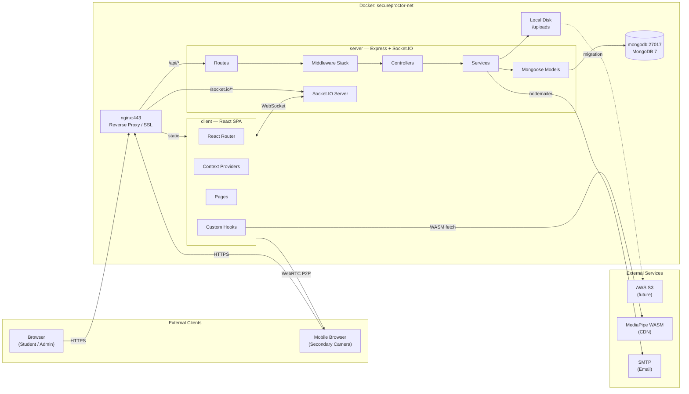
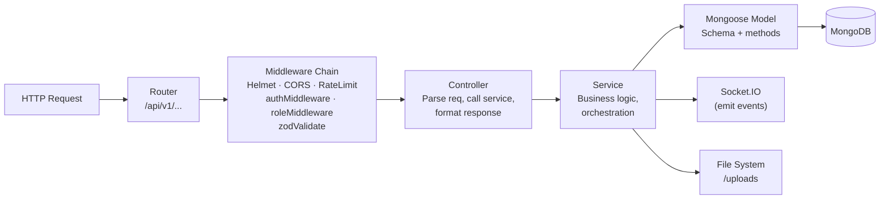
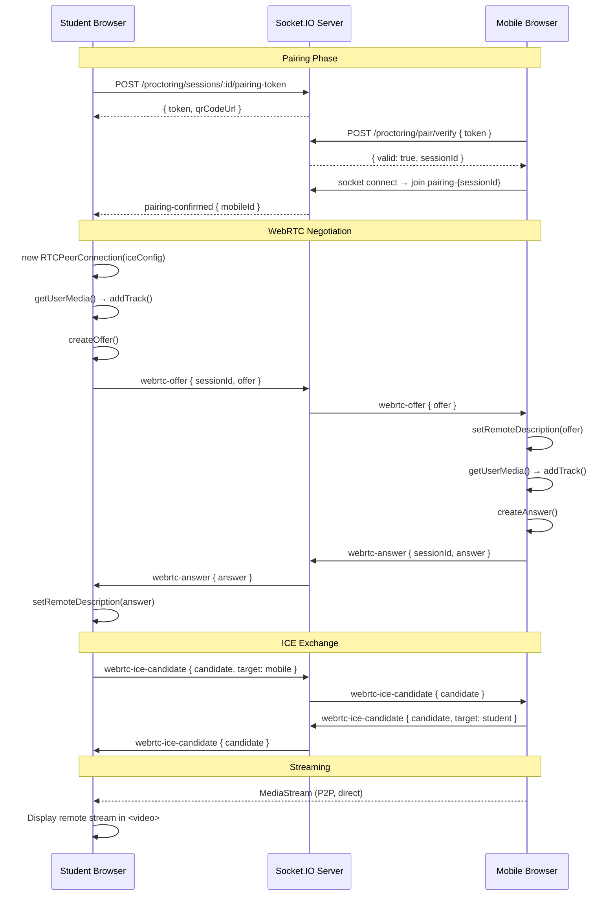
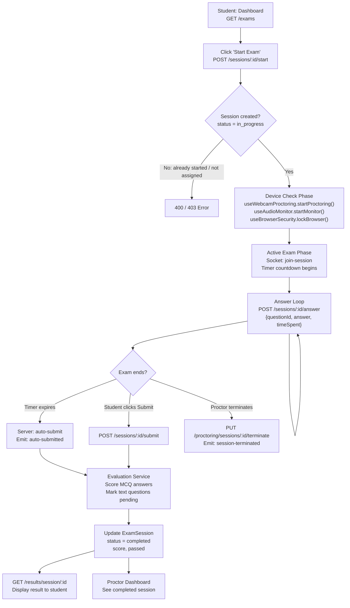
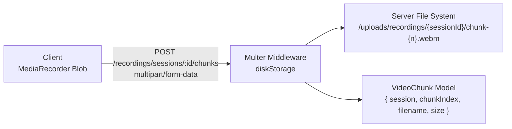
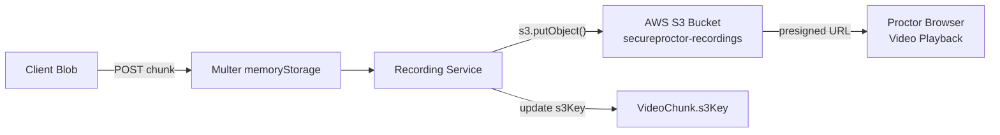
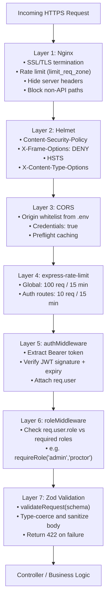
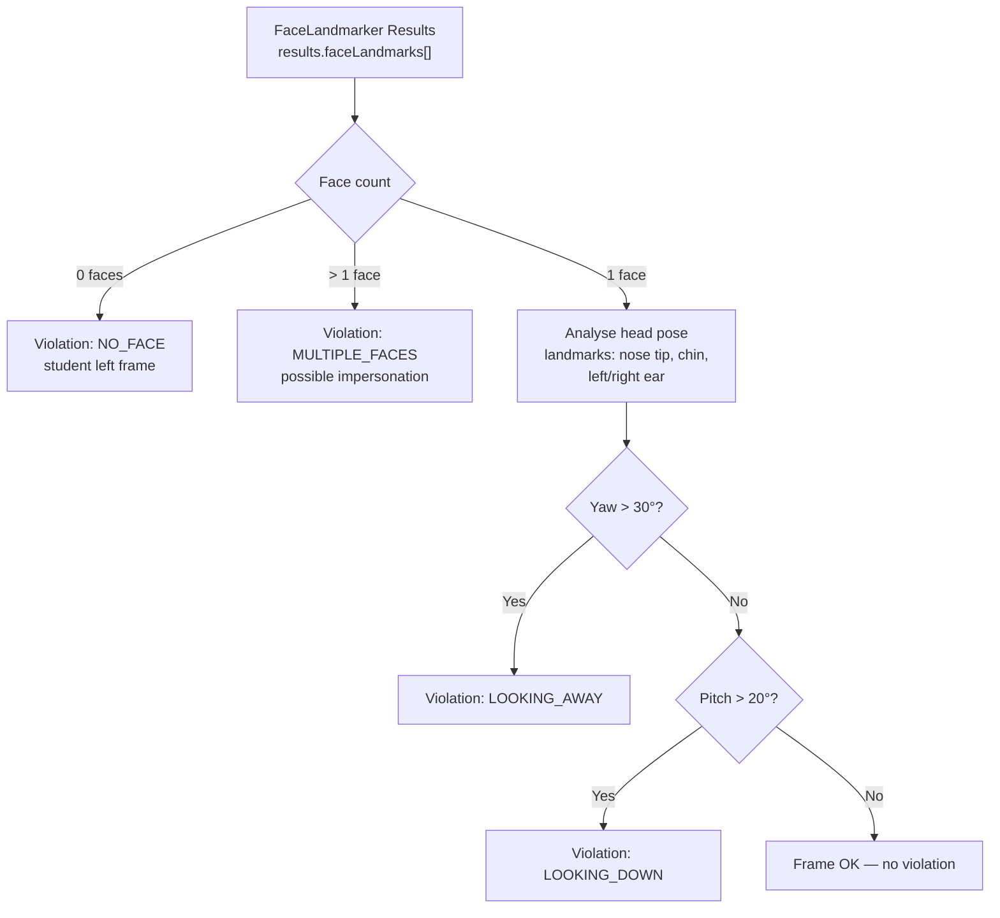

# SecureProctor — System Architecture

> **Version:** 1.0  
> **Last Updated:** 2025  
> **Stack:** React 18 · Node.js / Express · MongoDB · Socket.IO · WebRTC · MediaPipe

---

## Table of Contents

1. [System Overview](#1-system-overview)
2. [Component Diagram](#2-component-diagram)
3. [Frontend Architecture](#3-frontend-architecture)
4. [Backend Architecture](#4-backend-architecture)
5. [Real-Time Communication](#5-real-time-communication)
6. [WebRTC Signaling Flow](#6-webrtc-signaling-flow)
7. [Exam Session Data Flow](#7-exam-session-data-flow)
8. [File Storage Architecture](#8-file-storage-architecture)
9. [Security Layers](#9-security-layers)
10. [MediaPipe Integration](#10-mediapipe-integration)

---

## 1. System Overview

SecureProctor is a browser-based online examination platform with real-time AI-powered proctoring. It is deployed as a **four-service Docker Compose application**:

| Service | Image / Source | Role |
|---------|---------------|------|
| `nginx` | `nginx:alpine` | Reverse proxy, SSL termination, static asset serving |
| `client` | Custom React build | Single-page application served via Nginx |
| `server` | Custom Node.js image | REST API + Socket.IO server |
| `mongodb` | `mongo:7` | Primary data store |

All external traffic enters through Nginx on ports `80` / `443`. Nginx routes `/api/*` and `/socket.io/*` to the `server` container and all other paths to the `client` static bundle. Services communicate over the internal Docker bridge network `secureproctor-net`.

### Environment Tiers

| Tier | Description |
|------|-------------|
| `development` | `docker-compose.dev.yml` — hot-reload via volumes |
| `production` | `docker-compose.yml` — optimised multi-stage builds |

---

## 2. Component Diagram



---

## 3. Frontend Architecture

### 3.1 Technology Stack

| Concern | Library / Tool |
|---------|---------------|
| UI framework | React 18 (functional components) |
| Routing | React Router v6 |
| HTTP client | Axios (interceptors for JWT) |
| Real-time | `socket.io-client` |
| AI proctoring | MediaPipe Face Landmarker (WASM via CDN) |
| Video | WebRTC `getUserMedia`, `MediaRecorder` |
| State | React Context API + `useReducer` |
| Styling | CSS Modules / Tailwind CSS |
| Build | Vite |

### 3.2 Context Providers

```
<AuthProvider>               ← JWT token, user object, login/logout helpers
  <SocketProvider>           ← Single socket.io-client instance, reconnect logic
    <ExamSessionProvider>    ← Active exam state: question index, answers, timer
      <ProctorProvider>      ← Proctoring state: violation count, termination flag
        <App />
      </ProctorProvider>
    </ExamSessionProvider>
  </SocketProvider>
</AuthProvider>
```

Each provider exposes a typed context object consumed via a paired custom hook (e.g. `useAuth()`, `useSocket()`, `useExamSession()`).

### 3.3 Custom Hooks

#### `useWebcamProctoring`

Manages the primary webcam feed used for AI proctoring.

```
Responsibilities:
  • Request camera permission via getUserMedia({ video: true })
  • Pipe the stream to a <video> element ref
  • Start/stop the MediaPipe frame-analysis loop
  • Emit violation events via socket / API
  • Expose: { videoRef, isReady, violationCount, startProctoring, stopProctoring }
```

#### `useAudioMonitor`

Monitors the microphone for sustained audio that may indicate talking.

```
Responsibilities:
  • getUserMedia({ audio: true })
  • Create AudioContext + AnalyserNode
  • Poll RMS level on requestAnimationFrame
  • Debounce short spikes; emit "audio_violation" after threshold duration
  • Expose: { isTalking, audioLevel, startMonitor, stopMonitor }
```

#### `useBrowserSecurity`

Detects and reports browser-integrity violations.

```
Responsibilities:
  • Listen to: visibilitychange, blur, fullscreenchange, keydown (PrintScreen / Alt-Tab)
  • Count tab-switch events; emit after threshold
  • Request and monitor Fullscreen API; warn on exit
  • Disable right-click context menu and text selection
  • Expose: { tabSwitchCount, isFullscreen, lockBrowser, unlockBrowser }
```

#### `useWebRTC`

Manages peer-to-peer connection to the student's secondary mobile camera.

```
Responsibilities:
  • Create RTCPeerConnection with STUN/TURN config
  • Handle offer/answer exchange via Socket.IO signaling channel
  • Add ICE candidates incrementally
  • Expose remote MediaStream for display in proctor dashboard
  • Expose: { remoteStream, connectionState, initiateCall, hangUp }
```

### 3.4 Page Structure

```
src/
├── pages/
│   ├── auth/           Login, Register, ForgotPassword, ResetPassword
│   ├── student/        Dashboard, ExamLobby, ExamSession, Results
│   ├── admin/          Dashboard, ExamManager, QuestionBank, UserManager
│   └── proctor/        ProctorDashboard, SessionMonitor, ReviewEvents
├── components/
│   ├── exam/           QuestionCard, TimerDisplay, AnswerPanel
│   ├── proctoring/     WebcamPreview, ViolationLog, SecondaryCamera
│   └── ui/             Modal, Button, Alert, Spinner
├── hooks/              (custom hooks listed above)
├── context/            (providers listed above)
├── services/           api.js (Axios instance), socket.js
└── utils/              validators, formatters, constants
```

---

## 4. Backend Architecture

### 4.1 Technology Stack

| Concern | Library |
|---------|---------|
| Framework | Express 4 |
| ODM | Mongoose 8 |
| Authentication | JWT (`jsonwebtoken`) + `bcryptjs` |
| Real-time | Socket.IO 4 |
| Validation | Zod |
| File upload | Multer |
| Email | Nodemailer |
| Security | Helmet, cors, express-rate-limit |

### 4.2 Layer Architecture



### 4.3 Directory Structure

```
server/
├── src/
│   ├── config/         db.js, socket.js, multer.js, constants.js
│   ├── models/         User, Exam, Question, ExamSession, ProctoringEvent,
│   │                   VideoChunk, PairingToken
│   ├── routes/         auth, users, exams, questions, sessions,
│   │                   proctoring, results, analytics, recordings
│   ├── controllers/    (one per route file)
│   ├── services/       authService, examService, sessionService,
│   │                   proctoringService, analyticsService, recordingService
│   ├── middleware/     authMiddleware, roleMiddleware, validateRequest,
│   │                   errorHandler, rateLimiter
│   ├── utils/          ApiError.js, asyncHandler.js, jwtUtils.js, emailUtils.js
│   └── app.js          Express app factory
└── server.js           HTTP server + Socket.IO bootstrap
```

### 4.4 Mongoose Models

| Model | Key Fields |
|-------|-----------|
| `User` | `name, email, passwordHash, role (student/admin/proctor), isActive` |
| `Exam` | `title, description, questions[], duration, passMark, status, assignedStudents[]` |
| `Question` | `text, type (mcq/text), options[], correctAnswer, marks, category` |
| `ExamSession` | `exam, student, status, answers[], startTime, endTime, score, violations` |
| `ProctoringEvent` | `session, type, severity, timestamp, metadata, reviewStatus, reviewedBy` |
| `VideoChunk` | `session, chunkIndex, filename, size, uploadedAt, s3Key` |
| `PairingToken` | `session, token, expiresAt, usedAt, mobileSocketId` |

---

## 5. Real-Time Communication

### 5.1 Socket.IO Architecture

The Socket.IO server runs on the same HTTP server as Express. Namespaces and rooms provide isolation:

| Namespace | Purpose |
|-----------|---------|
| `/` (default) | General events; authenticated via JWT in `auth` handshake query |

### 5.2 Rooms

| Room Pattern | Members | Purpose |
|-------------|---------|---------|
| `exam-session-{sessionId}` | Student + all proctors monitoring that session | Bidirectional session events |
| `proctor-exam-{examId}` | All proctors assigned to an exam | Aggregate monitoring dashboard |
| `pairing-{sessionId}` | Student browser + mobile browser | WebRTC signaling channel |

### 5.3 Socket Events

#### Client → Server

| Event | Payload | Description |
|-------|---------|-------------|
| `join-session` | `{ sessionId, token }` | Student joins exam room |
| `proctor-join` | `{ examId, token }` | Proctor joins exam monitoring room |
| `violation-event` | `{ sessionId, type, severity, metadata }` | Report a proctoring violation |
| `webrtc-offer` | `{ sessionId, offer }` | Student sends SDP offer to mobile |
| `webrtc-answer` | `{ sessionId, answer }` | Mobile sends SDP answer |
| `webrtc-ice-candidate` | `{ sessionId, candidate, target }` | Exchange ICE candidates |
| `pairing-request` | `{ sessionId, token }` | Mobile verifies pairing token |
| `heartbeat` | `{ sessionId }` | Keep session alive every 30 s |

#### Server → Client

| Event | Payload | Description |
|-------|---------|-------------|
| `session-joined` | `{ sessionId, examTitle }` | Confirm room join |
| `violation-logged` | `{ event }` | Broadcast violation to proctor room |
| `session-terminated` | `{ reason }` | Force-end exam (proctor action) |
| `session-warning` | `{ message }` | Send warning to student |
| `webrtc-offer` | `{ offer }` | Relay offer to mobile peer |
| `webrtc-answer` | `{ answer }` | Relay answer to student |
| `webrtc-ice-candidate` | `{ candidate }` | Relay ICE candidate |
| `pairing-confirmed` | `{ mobileId }` | Notify student mobile connected |
| `time-warning` | `{ remainingSeconds }` | 10-min / 5-min exam timer warnings |
| `auto-submitted` | `{ sessionId }` | Server submitted exam on time expiry |

---

## 6. WebRTC Signaling Flow

Secondary camera support allows a student to connect their mobile phone as a secondary video feed that proctors can view.



### ICE Server Configuration

```json
{
  "iceServers": [
    { "urls": "stun:stun.l.google.com:19302" },
    { "urls": "stun:stun1.l.google.com:19302" },
    {
      "urls": "turn:your-turn-server.example.com:3478",
      "username": "proctor",
      "credential": "<secret>"
    }
  ]
}
```

---

## 7. Exam Session Data Flow



### Session Status State Machine

```
created → in_progress → completed
                      ↘ terminated
```

| Status | Trigger |
|--------|---------|
| `created` | Student enrolled in exam |
| `in_progress` | `POST /sessions/:id/start` called |
| `completed` | Student submitted or auto-submitted |
| `terminated` | Proctor action or critical violation threshold |

---

## 8. File Storage Architecture

### 8.1 Current: Local Disk via Multer



**Multer configuration:**

```js
const storage = multer.diskStorage({
  destination: (req, file, cb) => {
    const dir = path.join('uploads', 'recordings', req.params.id);
    fs.mkdirSync(dir, { recursive: true });
    cb(null, dir);
  },
  filename: (req, file, cb) => {
    cb(null, `chunk-${Date.now()}.webm`);
  },
});

const upload = multer({
  storage,
  limits: { fileSize: 10 * 1024 * 1024 }, // 10 MB per chunk
  fileFilter: (req, file, cb) => {
    if (file.mimetype.startsWith('video/')) cb(null, true);
    else cb(new ApiError(400, 'Only video files are accepted'));
  },
});
```

### 8.2 Future: AWS S3 Migration Path



**Migration steps:**

1. Replace `multer.diskStorage` with `multer.memoryStorage`.
2. Add `@aws-sdk/client-s3` and configure with env vars (`AWS_REGION`, `AWS_ACCESS_KEY_ID`, `AWS_SECRET_ACCESS_KEY`, `S3_BUCKET`).
3. Upload `req.file.buffer` using `PutObjectCommand`.
4. Store returned S3 key in `VideoChunk.s3Key`.
5. Generate presigned URLs with `GetObjectCommand` + `getSignedUrl` for playback.

---

## 9. Security Layers

Requests pass through a defence-in-depth security stack before reaching any business logic.



### JWT Strategy

| Property | Value |
|----------|-------|
| Algorithm | `HS256` |
| Access token TTL | `15m` |
| Refresh token TTL | `7d` |
| Storage (client) | `httpOnly` cookie (access) + localStorage refresh fallback |
| Rotation | Refresh token rotated on each use |

### Password Security

- Stored as `bcrypt` hash with **salt rounds = 12**.
- Reset tokens are `crypto.randomBytes(32)` hashed with `SHA-256` before DB storage.

---

## 10. MediaPipe Integration

### 10.1 Loading Strategy

MediaPipe WASM assets are loaded from the CDN at runtime to avoid bundling large binary files:

```js
import { FaceLandmarker, FilesetResolver } from '@mediapipe/tasks-vision';

const filesetResolver = await FilesetResolver.forVisionTasks(
  'https://cdn.jsdelivr.net/npm/@mediapipe/tasks-vision/wasm'
);

const faceLandmarker = await FaceLandmarker.createFromOptions(filesetResolver, {
  baseOptions: {
    modelAssetPath:
      'https://storage.googleapis.com/mediapipe-models/face_landmarker/face_landmarker/float16/1/face_landmarker.task',
    delegate: 'GPU',  // falls back to CPU
  },
  outputFaceBlendshapes: true,
  runningMode: 'VIDEO',
  numFaces: 2,         // detect >1 face as violation
});
```

### 10.2 Frame Analysis Loop

```js
let lastVideoTime = -1;

const detectFrame = () => {
  if (videoRef.current.currentTime !== lastVideoTime) {
    lastVideoTime = videoRef.current.currentTime;

    const results = faceLandmarker.detectForVideo(
      videoRef.current,
      performance.now()
    );

    analyzeResults(results);
  }
  requestAnimationFrame(detectFrame);
};
```

### 10.3 Violation Detection Logic



### 10.4 Violation Escalation

| Consecutive Violations | Action |
|-----------------------|--------|
| 1 – 2 | Log to `ProctoringEvent` (severity: `low`) |
| 3 – 5 | Emit `session-warning` via Socket.IO; log (severity: `medium`) |
| 6 – 9 | Emit second warning; log (severity: `high`) |
| ≥ 10 | Call `POST /proctoring/sessions/:id/terminate` automatically |

Head-pose angles are estimated from 3D landmark coordinates using a simplified PnP approximation (no external library required).
