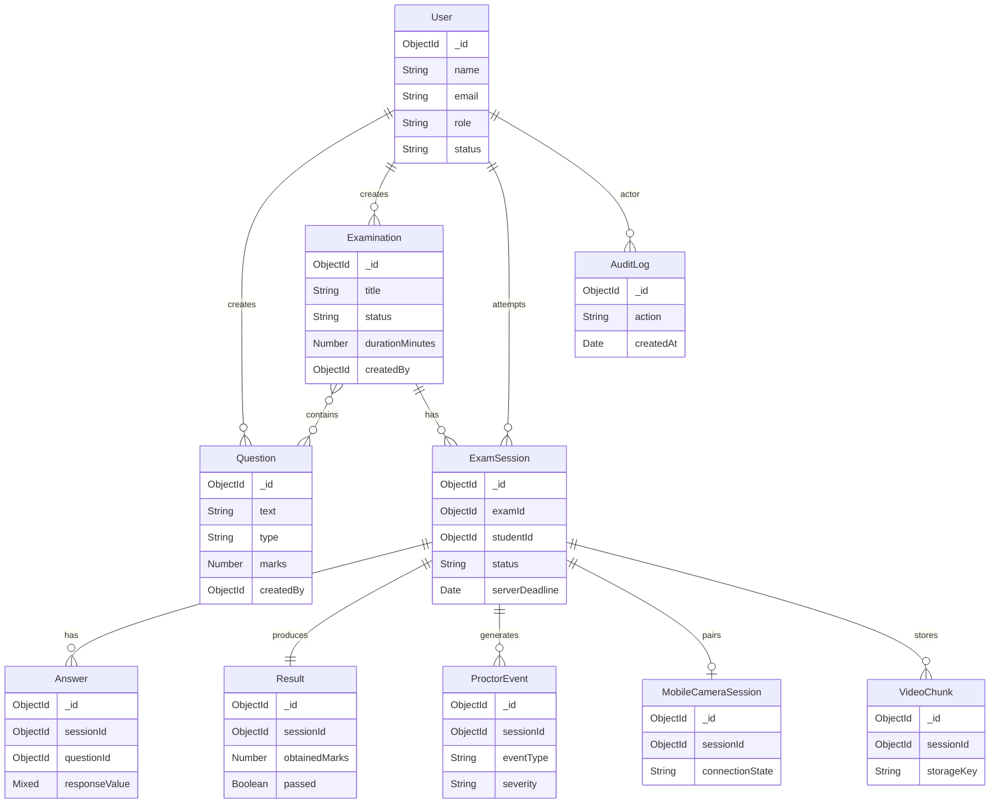

# Database Schema Reference

> [!NOTE]
> SecureProctor uses **MongoDB** (via Mongoose) as its primary datastore. All schemas are defined in `backend/src/models/`. Timestamps (`createdAt`, `updatedAt`) are added automatically by Mongoose's `timestamps: true` option unless noted otherwise.

---

## Table of Contents

1. [User](#1-user)
2. [Question](#2-question)
3. [Examination](#3-examination)
4. [ExamSession](#4-examsession)
5. [Answer](#5-answer)
6. [Result](#6-result)
7. [ProctorEvent](#7-proctorevent)
8. [MobileCameraSession](#8-mobilecamerasession)
9. [VideoChunk](#9-videochunk)
10. [AuditLog](#10-auditlog)
11. [Entity-Relationship Diagram](#entity-relationship-diagram)

---

## 1. User

**File:** `backend/src/models/User.js`

Stores all system users — administrators, proctors, and students.

### Fields

| Field | Type | Required | Default | Notes |
|---|---|---|---|---|
| `name` | String | ✅ | — | Trimmed |
| `email` | String | ✅ | — | Unique, lowercase |
| `passwordHash` | String | ✅ | — | bcrypt, cost 12 |
| `role` | String (enum) | ✅ | `"student"` | `admin` / `proctor` / `student` |
| `status` | String (enum) | ✅ | `"active"` | `active` / `inactive` / `suspended` |
| `studentId` | String | ❌ | — | Only for students |
| `department` | String | ❌ | — | Optional |
| `resetPasswordToken` | String | ❌ | — | Hashed reset token |
| `resetPasswordExpires` | Date | ❌ | — | Expiry of reset token |
| `lastLogin` | Date | ❌ | — | Updated on successful login |

### Indexes

| Fields | Type | Notes |
|---|---|---|
| `email` | Unique | Primary lookup key |
| `role` | Standard | Filter by role |
| `status` | Standard | Filter active users |

### Relationships

- **One-to-Many → ExamSession** (via `studentId`)
- **One-to-Many → ProctorEvent** (via `studentId`)
- **One-to-Many → Question** (via `createdBy`)
- **One-to-Many → Examination** (via `createdBy`)
- **One-to-Many → AuditLog** (via `actor.userId`)

### Example Document

```json
{
  "_id": "64a1f2c3e4b5d6789012abcd",
  "name": "Alice Johnson",
  "email": "alice@university.edu",
  "passwordHash": "$2b$12$...",
  "role": "student",
  "status": "active",
  "studentId": "STU-2024-001",
  "department": "Computer Science",
  "resetPasswordToken": null,
  "resetPasswordExpires": null,
  "lastLogin": "2024-01-15T09:30:00.000Z",
  "createdAt": "2024-01-01T00:00:00.000Z",
  "updatedAt": "2024-01-15T09:30:00.000Z"
}
```

---

## 2. Question

**File:** `backend/src/models/Question.js`

A bank of reusable exam questions. Questions are authored once and referenced by multiple examinations.

### Fields

| Field | Type | Required | Default | Notes |
|---|---|---|---|---|
| `text` | String | ✅ | — | Question body (supports markdown) |
| `type` | String (enum) | ✅ | — | `mcq` / `multiple_select` / `true_false` / `short_answer` |
| `options` | Array | ❌ | `[]` | Only for `mcq`, `multiple_select`, `true_false` |
| `options[].text` | String | ✅ (if option) | — | Display text |
| `options[].isCorrect` | Boolean | ✅ (if option) | `false` | Stripped before sending to client |
| `marks` | Number | ✅ | `1` | Positive marks for correct answer |
| `negativeMark` | Number | ❌ | `0` | Marks deducted for wrong answer |
| `acceptedAnswers` | Array\<String\> | ❌ | `[]` | For `short_answer`; never sent to client |
| `difficulty` | String (enum) | ❌ | `"medium"` | `easy` / `medium` / `hard` |
| `tags` | Array\<String\> | ❌ | `[]` | For filtering/categorisation |
| `createdBy` | ObjectId (ref: User) | ✅ | — | Admin/proctor who created it |

### Indexes

| Fields | Type | Notes |
|---|---|---|
| `type` | Standard | Filter by question type |
| `difficulty` | Standard | Filter by difficulty |
| `tags` | Standard | Filter by tags |
| `createdBy` | Standard | Filter by author |

### Relationships

- **Many-to-One → User** (`createdBy`)
- **Many-to-Many → Examination** (referenced in `Examination.questions`)

### Example Document

```json
{
  "_id": "64b2a3d4e5c6f789012bcde",
  "text": "Which of the following are JavaScript primitive types?",
  "type": "multiple_select",
  "options": [
    { "_id": "...", "text": "String",  "isCorrect": true  },
    { "_id": "...", "text": "Object",  "isCorrect": false },
    { "_id": "...", "text": "Number",  "isCorrect": true  },
    { "_id": "...", "text": "Array",   "isCorrect": false }
  ],
  "marks": 2,
  "negativeMark": 0.5,
  "acceptedAnswers": [],
  "difficulty": "medium",
  "tags": ["javascript", "fundamentals"],
  "createdBy": "64a1f2c3e4b5d6789012abcd",
  "createdAt": "2024-01-10T08:00:00.000Z",
  "updatedAt": "2024-01-10T08:00:00.000Z"
}
```

---

## 3. Examination

**File:** `backend/src/models/Examination.js`

Represents a scheduled exam with all its configuration, assigned students, and proctoring policy.

### Fields

| Field | Type | Required | Default | Notes |
|---|---|---|---|---|
| `title` | String | ✅ | — | Display name |
| `description` | String | ❌ | — | Rich text description |
| `instructions` | String | ❌ | — | Shown to student before start |
| `status` | String (enum) | ✅ | `"draft"` | `draft` / `published` / `archived` / `cancelled` |
| `durationMinutes` | Number | ✅ | — | Exam duration in minutes |
| `scheduledStart` | Date | ✅ | — | Exam window opens |
| `scheduledEnd` | Date | ✅ | — | Exam window closes |
| `totalMarks` | Number | ✅ | — | Sum of all question marks |
| `passingScore` | Number | ✅ | — | Minimum marks to pass |
| `maxAttempts` | Number | ❌ | `1` | Max attempts per student |
| `questionCount` | Number | ✅ | — | How many questions to serve |
| `randomizeQuestions` | Boolean | ❌ | `false` | Shuffle question order |
| `randomizeOptions` | Boolean | ❌ | `false` | Shuffle option order |
| `negativeMarking` | Boolean | ❌ | `false` | Enable negative marking |
| `negativeMarkValue` | Number | ❌ | `0` | Global negative mark override |
| `questions` | Array\<ObjectId\> (ref: Question) | ✅ | `[]` | Question pool |
| `assignedStudents` | Array\<ObjectId\> (ref: User) | ❌ | `[]` | Enrolled students |
| `proctoringPolicy` | Object | ❌ | — | Proctoring configuration |
| `proctoringPolicy.requireWebcam` | Boolean | ❌ | `true` | |
| `proctoringPolicy.requireFullscreen` | Boolean | ❌ | `true` | |
| `proctoringPolicy.allowMultipleFaces` | Boolean | ❌ | `false` | |
| `proctoringPolicy.maxViolations` | Number | ❌ | `5` | Auto-submit threshold |
| `proctoringPolicy.autoSubmitOnViolation` | Boolean | ❌ | `true` | |
| `createdBy` | ObjectId (ref: User) | ✅ | — | Admin who created it |

### Indexes

| Fields | Type | Notes |
|---|---|---|
| `status` | Standard | List by status |
| `scheduledStart` | Standard | Time-range queries |
| `assignedStudents` | Standard | Student's exam list |
| `createdBy` | Standard | Admin ownership |

### Relationships

- **Many-to-One → User** (`createdBy`)
- **Many-to-Many → Question** (`questions` array of refs)
- **Many-to-Many → User** (`assignedStudents`)
- **One-to-Many → ExamSession**

### Example Document

```json
{
  "_id": "64c3b4e5f6d7a890123cdef",
  "title": "Midterm CS101 — January 2024",
  "description": "Covers chapters 1–5.",
  "instructions": "No calculators. Read each question carefully.",
  "status": "published",
  "durationMinutes": 90,
  "scheduledStart": "2024-01-20T09:00:00.000Z",
  "scheduledEnd":   "2024-01-20T12:00:00.000Z",
  "totalMarks": 100,
  "passingScore": 40,
  "maxAttempts": 1,
  "questionCount": 50,
  "randomizeQuestions": true,
  "randomizeOptions": true,
  "negativeMarking": true,
  "negativeMarkValue": 0.25,
  "questions": ["64b2a3d4e5c6f789012bcde", "..."],
  "assignedStudents": ["64a1f2c3e4b5d6789012abcd", "..."],
  "proctoringPolicy": {
    "requireWebcam": true,
    "requireFullscreen": true,
    "allowMultipleFaces": false,
    "maxViolations": 5,
    "autoSubmitOnViolation": true
  },
  "createdBy": "64a000000000000000000001",
  "createdAt": "2024-01-05T10:00:00.000Z",
  "updatedAt": "2024-01-18T14:30:00.000Z"
}
```

---

## 4. ExamSession

**File:** `backend/src/models/ExamSession.js`

Tracks a single attempt by a student at an exam. One session = one attempt.

### Fields

| Field | Type | Required | Default | Notes |
|---|---|---|---|---|
| `examId` | ObjectId (ref: Examination) | ✅ | — | |
| `studentId` | ObjectId (ref: User) | ✅ | — | |
| `status` | String (enum) | ✅ | `"initialized"` | `initialized` / `device_check` / `active` / `completed` / `terminated` |
| `serverDeadline` | Date | ❌ | — | Set on exam start; enforced server-side |
| `questionOrder` | Array\<ObjectId\> | ❌ | `[]` | Randomised question sequence |
| `answers` | Array (embedded) | ❌ | `[]` | Inline cache; persisted via Answer model |
| `startTime` | Date | ❌ | — | When student clicked "Start Exam" |
| `endTime` | Date | ❌ | — | When exam was submitted/terminated |
| `deviceCheckCompleted` | Boolean | ❌ | `false` | Passed webcam/fullscreen check |
| `heartbeatAt` | Date | ❌ | — | Last received heartbeat |
| `warningsCount` | Number | ❌ | `0` | Qualifying violations accumulated |
| `terminationReason` | String | ❌ | — | Why session was force-ended |

### Indexes

| Fields | Type | Notes |
|---|---|---|
| `examId` | Standard | All sessions for an exam |
| `studentId` | Standard | Student's sessions |
| `(examId, studentId)` | Compound | Unique attempt check |
| `status` | Standard | Active sessions |

### Relationships

- **Many-to-One → Examination** (`examId`)
- **Many-to-One → User** (`studentId`)
- **One-to-Many → Answer**
- **One-to-One → Result**
- **One-to-Many → ProctorEvent**
- **One-to-Many → VideoChunk**
- **One-to-One → MobileCameraSession**

### Example Document

```json
{
  "_id": "64d4c5f6a7e8b901234defg",
  "examId": "64c3b4e5f6d7a890123cdef",
  "studentId": "64a1f2c3e4b5d6789012abcd",
  "status": "active",
  "serverDeadline": "2024-01-20T10:32:00.000Z",
  "questionOrder": ["64b2a3d4...", "..."],
  "startTime": "2024-01-20T09:02:00.000Z",
  "endTime": null,
  "deviceCheckCompleted": true,
  "heartbeatAt": "2024-01-20T09:15:45.000Z",
  "warningsCount": 1,
  "terminationReason": null,
  "createdAt": "2024-01-20T09:00:05.000Z",
  "updatedAt": "2024-01-20T09:15:45.000Z"
}
```

---

## 5. Answer

**File:** `backend/src/models/Answer.js`

Persists a student's response to a single question. Auto-saved continuously during the exam.

### Fields

| Field | Type | Required | Default | Notes |
|---|---|---|---|---|
| `sessionId` | ObjectId (ref: ExamSession) | ✅ | — | |
| `questionId` | ObjectId (ref: Question) | ✅ | — | |
| `responseValue` | Mixed | ❌ | — | String (MCQ/short) or Array\<String\> (multi-select) |
| `isSkipped` | Boolean | ❌ | `false` | Explicitly skipped by student |
| `timeSpentSeconds` | Number | ❌ | `0` | Cumulative time on this question |
| `revisions` | Number | ❌ | `0` | How many times student changed answer |
| `savedAt` | Date | ❌ | `Date.now` | Last upsert timestamp |

### Indexes

| Fields | Type | Notes |
|---|---|---|
| `(sessionId, questionId)` | **Unique** | One answer per question per session |
| `sessionId` | Standard | All answers for a session |

### Relationships

- **Many-to-One → ExamSession** (`sessionId`)
- **Many-to-One → Question** (`questionId`)

### Example Document

```json
{
  "_id": "64e5d6a7b8f9c012345efgh",
  "sessionId": "64d4c5f6a7e8b901234defg",
  "questionId": "64b2a3d4e5c6f789012bcde",
  "responseValue": ["String", "Number"],
  "isSkipped": false,
  "timeSpentSeconds": 47,
  "revisions": 2,
  "savedAt": "2024-01-20T09:12:33.000Z"
}
```

---

## 6. Result

**File:** `backend/src/models/Result.js`

Computed result for a completed exam session. Generated by the result-calculation service.

### Fields

| Field | Type | Required | Default | Notes |
|---|---|---|---|---|
| `sessionId` | ObjectId (ref: ExamSession) | ✅ | — | **Unique** |
| `examId` | ObjectId (ref: Examination) | ✅ | — | Denormalized for queries |
| `studentId` | ObjectId (ref: User) | ✅ | — | Denormalized for queries |
| `totalMarks` | Number | ✅ | — | Max possible marks |
| `obtainedMarks` | Number | ✅ | — | Actual marks (can be negative) |
| `percentage` | Number | ✅ | — | `(obtained / total) * 100` |
| `passed` | Boolean | ✅ | — | `obtainedMarks >= passingScore` |
| `grade` | String | ❌ | — | Letter grade (A/B/C/D/F) |
| `correctCount` | Number | ✅ | — | Number of correct answers |
| `wrongCount` | Number | ✅ | — | Number of wrong answers |
| `skippedCount` | Number | ✅ | — | Number of skipped questions |
| `questionBreakdown` | Array | ❌ | `[]` | Per-question detail |
| `questionBreakdown[].questionId` | ObjectId | ✅ | — | |
| `questionBreakdown[].correct` | Boolean | ✅ | — | |
| `questionBreakdown[].marksAwarded` | Number | ✅ | — | Positive or negative |
| `evaluatedAt` | Date | ✅ | `Date.now` | When result was calculated |

### Indexes

| Fields | Type | Notes |
|---|---|---|
| `sessionId` | **Unique** | One result per session |
| `examId` | Standard | Results for an exam |
| `studentId` | Standard | Student's results |
| `(examId, studentId)` | Compound | Student result per exam |

### Relationships

- **One-to-One → ExamSession** (`sessionId`)
- **Many-to-One → Examination** (`examId`)
- **Many-to-One → User** (`studentId`)

### Example Document

```json
{
  "_id": "64f6e7b8c9a0d123456fghi",
  "sessionId": "64d4c5f6a7e8b901234defg",
  "examId": "64c3b4e5f6d7a890123cdef",
  "studentId": "64a1f2c3e4b5d6789012abcd",
  "totalMarks": 100,
  "obtainedMarks": 67.5,
  "percentage": 67.5,
  "passed": true,
  "grade": "B",
  "correctCount": 38,
  "wrongCount": 8,
  "skippedCount": 4,
  "questionBreakdown": [
    {
      "questionId": "64b2a3d4e5c6f789012bcde",
      "correct": true,
      "marksAwarded": 2
    }
  ],
  "evaluatedAt": "2024-01-20T10:35:00.000Z",
  "createdAt": "2024-01-20T10:35:00.000Z"
}
```

---

## 7. ProctorEvent

**File:** `backend/src/models/ProctorEvent.js`

Records each proctoring violation or suspicious behaviour detected during an exam.

### Fields

| Field | Type | Required | Default | Notes |
|---|---|---|---|---|
| `sessionId` | ObjectId (ref: ExamSession) | ✅ | — | |
| `examId` | ObjectId (ref: Examination) | ✅ | — | Denormalized |
| `studentId` | ObjectId (ref: User) | ✅ | — | Denormalized |
| `eventType` | String (enum) | ✅ | — | See Event Types table |
| `severity` | String (enum) | ✅ | — | `low` / `medium` / `high` / `critical` |
| `metadata` | Mixed (JSON) | ❌ | `{}` | Contextual data (e.g., face count) |
| `timestamp` | Date | ✅ | `Date.now` | When event occurred |
| `reviewStatus` | String (enum) | ✅ | `"pending"` | `pending` / `reviewed` / `dismissed` / `escalated` |
| `reviewedBy` | ObjectId (ref: User) | ❌ | — | Proctor who reviewed |
| `reviewNotes` | String | ❌ | — | Proctor's notes |

### Indexes

| Fields | Type | Notes |
|---|---|---|
| `sessionId` | Standard | Events for a session |
| `examId` | Standard | Events for an exam |
| `studentId` | Standard | Events for a student |
| `reviewStatus` | Standard | Filter pending reviews |
| `(sessionId, eventType, timestamp)` | Compound | Deduplication window |

### Relationships

- **Many-to-One → ExamSession** (`sessionId`)
- **Many-to-One → Examination** (`examId`)
- **Many-to-One → User** (`studentId`, `reviewedBy`)

### Example Document

```json
{
  "_id": "65071829d0b1e234567ghij",
  "sessionId": "64d4c5f6a7e8b901234defg",
  "examId": "64c3b4e5f6d7a890123cdef",
  "studentId": "64a1f2c3e4b5d6789012abcd",
  "eventType": "multiple_faces",
  "severity": "high",
  "metadata": { "faceCount": 2 },
  "timestamp": "2024-01-20T09:20:15.000Z",
  "reviewStatus": "pending",
  "reviewedBy": null,
  "reviewNotes": null,
  "createdAt": "2024-01-20T09:20:15.000Z"
}
```

---

## 8. MobileCameraSession

**File:** `backend/src/models/MobileCameraSession.js`

Manages the pairing state between a student's primary browser session and their mobile secondary camera.

### Fields

| Field | Type | Required | Default | Notes |
|---|---|---|---|---|
| `sessionId` | ObjectId (ref: ExamSession) | ✅ | — | |
| `examId` | ObjectId (ref: Examination) | ✅ | — | Denormalized |
| `studentId` | ObjectId (ref: User) | ✅ | — | Denormalized |
| `pairingToken` | String | ✅ | — | Short-lived token encoded in QR |
| `tokenExpiresAt` | Date | ✅ | — | Typically 5 minutes from creation |
| `connectionState` | String (enum) | ✅ | `"pending"` | `pending` / `connected` / `disconnected` |
| `deviceInfo` | Object | ❌ | — | Mobile browser UA, OS |
| `pairedAt` | Date | ❌ | — | When mobile connected |

### Indexes

| Fields | Type | Notes |
|---|---|---|
| `sessionId` | Unique | One mobile session per exam session |
| `pairingToken` | Unique | Token lookup at pairing time |
| `tokenExpiresAt` | TTL | Auto-expire unpaired tokens |

### Relationships

- **One-to-One → ExamSession** (`sessionId`)

### Example Document

```json
{
  "_id": "6508293ae1c2f345678hijk",
  "sessionId": "64d4c5f6a7e8b901234defg",
  "examId": "64c3b4e5f6d7a890123cdef",
  "studentId": "64a1f2c3e4b5d6789012abcd",
  "pairingToken": "tk_7f3a2b1c",
  "tokenExpiresAt": "2024-01-20T09:07:00.000Z",
  "connectionState": "connected",
  "deviceInfo": {
    "userAgent": "Mozilla/5.0 (iPhone; CPU iPhone OS 17_0...)",
    "platform": "iOS"
  },
  "pairedAt": "2024-01-20T09:03:45.000Z",
  "createdAt": "2024-01-20T09:02:10.000Z"
}
```

---

## 9. VideoChunk

**File:** `backend/src/models/VideoChunk.js`

Tracks recorded video segments uploaded from the webcam during an exam session.

### Fields

| Field | Type | Required | Default | Notes |
|---|---|---|---|---|
| `sessionId` | ObjectId (ref: ExamSession) | ✅ | — | |
| `storageKey` | String | ✅ | — | Unique identifier (S3 key or local path) |
| `relativePath` | String | ✅ | — | Filesystem path relative to upload root |
| `mimeType` | String | ✅ | — | e.g., `video/webm` |
| `sizeBytes` | Number | ✅ | — | File size in bytes |
| `checksum` | String | ❌ | — | MD5/SHA256 for integrity verification |
| `uploadedAt` | Date | ✅ | `Date.now` | Server receipt time |

### Indexes

| Fields | Type | Notes |
|---|---|---|
| `sessionId` | Standard | All chunks for a session |
| `storageKey` | Unique | Deduplication |
| `uploadedAt` | Standard | Chronological playback |

### Relationships

- **Many-to-One → ExamSession** (`sessionId`)

### Example Document

```json
{
  "_id": "6509304bf2d3e456789ijkl",
  "sessionId": "64d4c5f6a7e8b901234defg",
  "storageKey": "sessions/64d4c5f6/chunk-001.webm",
  "relativePath": "uploads/sessions/64d4c5f6/chunk-001.webm",
  "mimeType": "video/webm",
  "sizeBytes": 2097152,
  "checksum": "a3f5b2c1d4e6f789...",
  "uploadedAt": "2024-01-20T09:05:30.000Z"
}
```

---

## 10. AuditLog

**File:** `backend/src/models/AuditLog.js`

Immutable log of all significant administrative and system actions for accountability.

### Fields

| Field | Type | Required | Default | Notes |
|---|---|---|---|---|
| `actor` | Object | ✅ | — | Who performed the action |
| `actor.userId` | ObjectId | ✅ | — | |
| `actor.name` | String | ✅ | — | Snapshot at time of action |
| `actor.email` | String | ✅ | — | Snapshot at time of action |
| `actor.role` | String | ✅ | — | Snapshot at time of action |
| `actor.ipAddress` | String | ❌ | — | Request IP |
| `actor.userAgent` | String | ❌ | — | Request user-agent |
| `action` | String (enum) | ✅ | — | See actions list below |
| `targetResource` | Object | ❌ | — | What was acted upon |
| `targetResource.resourceType` | String | ✅ | — | e.g., `Examination`, `User` |
| `targetResource.resourceId` | ObjectId | ✅ | — | |
| `details` | Mixed (JSON) | ❌ | `{}` | Additional context |
| `createdAt` | Date | ✅ | `Date.now` | Immutable; no `updatedAt` |

**Action enum values:** `user_created`, `user_updated`, `user_deleted`, `exam_created`, `exam_published`, `exam_archived`, `exam_cancelled`, `session_started`, `session_submitted`, `session_terminated`, `result_calculated`, `event_reviewed`, `question_created`, `question_updated`, `question_deleted`, `login_success`, `login_failed`, `password_reset`

### Indexes

| Fields | Type | Notes |
|---|---|---|
| `actor.userId` | Standard | All actions by a user |
| `action` | Standard | Filter by action type |
| `targetResource.resourceType` | Standard | Filter by resource |
| `createdAt` | Standard (TTL optional) | Chronological audit trail |

### Relationships

- **Many-to-One → User** (`actor.userId`) — soft reference (denormalized)

### Example Document

```json
{
  "_id": "650a415cf3e4f56789jklm",
  "actor": {
    "userId": "64a000000000000000000001",
    "name": "Dr. Admin",
    "email": "admin@university.edu",
    "role": "admin",
    "ipAddress": "192.168.1.50",
    "userAgent": "Mozilla/5.0 (Windows NT 10.0...)"
  },
  "action": "exam_published",
  "targetResource": {
    "resourceType": "Examination",
    "resourceId": "64c3b4e5f6d7a890123cdef"
  },
  "details": {
    "previousStatus": "draft",
    "newStatus": "published"
  },
  "createdAt": "2024-01-18T14:30:00.000Z"
}
```

---

## Entity-Relationship Diagram


