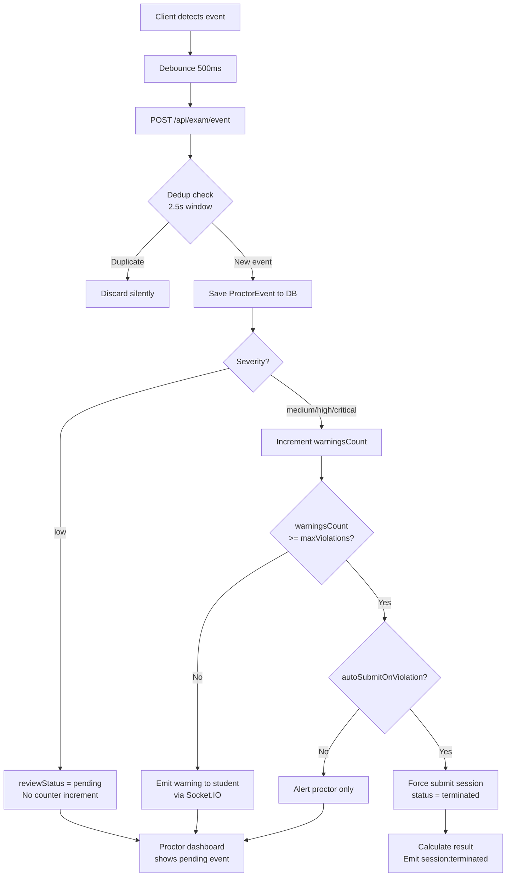
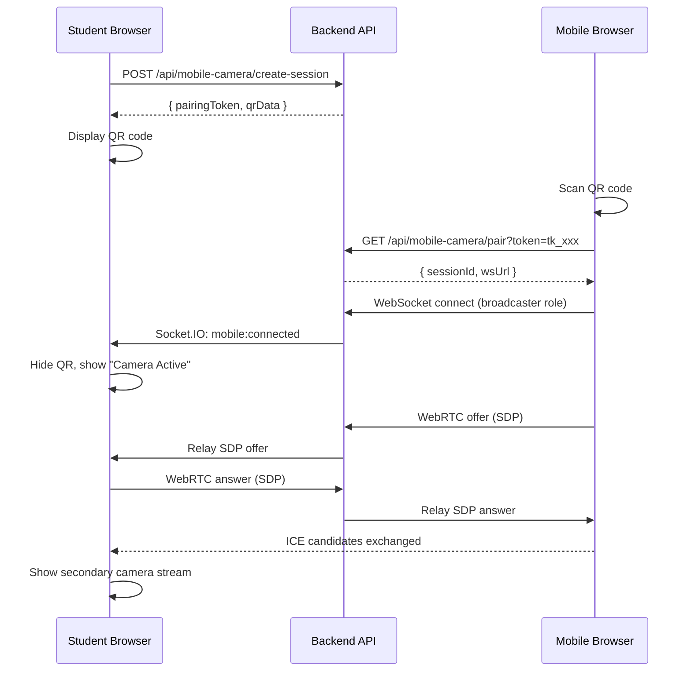

# AI Proctoring System

> [!NOTE]
> SecureProctor's proctoring subsystem is a multi-layered defence: client-side AI detection feeds events to a server-side escalation engine, while human proctors can review and override decisions in real time.

---

## Table of Contents

1. [Overview & Philosophy](#1-overview--philosophy)
2. [Client-Side Detection Pipeline](#2-client-side-detection-pipeline)
   - [MediaPipe Face Landmarker](#a-mediapipe-face-landmarker)
   - [Web Audio API — Noise Detection](#b-web-audio-api--noise-detection)
   - [Browser Security Controls](#c-browser-security-controls)
   - [WebRTC Secondary Camera](#d-webrtc-secondary-camera)
3. [Server-Side Event Processing](#3-server-side-event-processing)
4. [Event Types Reference](#4-event-types-reference)
5. [Escalation Flow](#5-escalation-flow)
6. [Proctor Review Workflow](#6-proctor-review-workflow)
7. [False Positive Handling](#7-false-positive-handling)
8. [Mobile Secondary Camera Pairing](#8-mobile-secondary-camera-pairing)
9. [Configuration Variables](#9-configuration-variables)

---

## 1. Overview & Philosophy

SecureProctor adopts a **graduated response** philosophy:

- **Detect broadly, escalate conservatively.** Low-confidence signals generate low-severity events for review only; only high-confidence, repeated violations trigger automatic action.
- **Human oversight is required.** Auto-submission only occurs when the violation threshold is crossed *and* the exam policy has it enabled. Proctors can always dismiss, review, or escalate events.
- **Privacy by design.** Webcam video is chunked and stored locally (or S3); facial landmark data is processed entirely on-device via WebAssembly and is never transmitted to the server. Only the *interpretation* (face count, head pose deviation) is sent.
- **Fail-safe defaults.** If the proctoring library fails to load, the exam is blocked rather than proceeding unmonitored.

---

## 2. Client-Side Detection Pipeline

All client-side proctoring runs inside the `ExamLivePage` React component and its associated hooks (`useFaceDetection`, `useAudioMonitor`, `useBrowserSecurity`).

### a. MediaPipe Face Landmarker

SecureProctor uses the [@mediapipe/tasks-vision](https://ai.google.dev/edge/mediapipe/solutions/vision/face_landmarker) package.

**Initialization sequence:**

```js
// Loading WASM from CDN
const vision = await FilesetResolver.forVisionTasks(
  "https://cdn.jsdelivr.net/npm/@mediapipe/tasks-vision/wasm"
);

const faceLandmarker = await FaceLandmarker.createFromOptions(vision, {
  baseOptions: {
    modelAssetPath:
      "https://storage.googleapis.com/mediapipe-models/face_landmarker/face_landmarker/float16/1/face_landmarker.task",
    delegate: "GPU",          // falls back to CPU automatically
  },
  runningMode: "VIDEO",
  numFaces: 4,               // detect up to 4 faces to catch cheating
  outputFaceBlendshapes: false,
  outputFacialTransformationMatrixes: true,  // enables head pose
});
```

**Frame loop:**

The hook drives detection using `requestAnimationFrame`. On each frame:

1. Call `faceLandmarker.detectForVideo(videoElement, performance.now())`.
2. Count detected faces → emit `face_absent` (0 faces) or `multiple_faces` (≥ 2).
3. Parse the facial transformation matrix to extract **Euler angles** (yaw, pitch, roll).
4. If |yaw| > 30° or |pitch| > 25° → emit `head_pose_deviation`.

**Key thresholds:**

| Check | Threshold | Event |
|---|---|---|
| Face count = 0 | Any frame | `face_absent` |
| Face count ≥ 2 | Any frame | `multiple_faces` |
| Yaw deviation | > 30° | `head_pose_deviation` |
| Pitch deviation | > 25° | `head_pose_deviation` |

Events are debounced client-side (500 ms) before being sent to the server, where the 2.5-second deduplication window applies.

---

### b. Web Audio API — Noise Detection

Audio monitoring detects sustained loud speech that could indicate collusion.

**Setup:**

```js
const stream = await navigator.mediaDevices.getUserMedia({ audio: true });
const audioContext = new AudioContext();
const source = audioContext.createMediaStreamSource(stream);
const analyser = audioContext.createAnalyser();
analyser.fftSize = 256;
source.connect(analyser);
```

**RMS calculation per frame:**

```js
const dataArray = new Uint8Array(analyser.frequencyBinCount);
analyser.getByteTimeDomainData(dataArray);

const rms = Math.sqrt(
  dataArray.reduce((sum, v) => sum + (v / 128 - 1) ** 2, 0) / dataArray.length
);
```

**Spike detection:**

- **Spike threshold:** RMS > **0.35**
- **Sustained detection:** **3 consecutive frames** above threshold → emit `audio_spike`
- Frame interval: 100 ms (via `setInterval`)

This 300 ms sustained window prevents brief non-speech sounds (coughs, chair scrapes) from triggering violations.

---

### c. Browser Security Controls

**Fullscreen enforcement:**

```js
document.addEventListener("fullscreenchange", () => {
  if (!document.fullscreenElement) {
    emitEvent("fullscreen_exit");
    // Re-prompt to re-enter fullscreen
  }
});
```

**Visibility & focus:**

```js
document.addEventListener("visibilitychange", () => {
  if (document.visibilityState === "hidden") emitEvent("tab_blur");
});

window.addEventListener("blur", () => emitEvent("window_blur"));
```

**Keyboard interception** — the following key combinations are blocked via `keydown` with `preventDefault()` and an event is optionally emitted:

| Key Combination | Action Blocked |
|---|---|
| `F12` | DevTools open |
| `Ctrl+Shift+I` | DevTools open |
| `Ctrl+Shift+J` | Console open |
| `Ctrl+U` | View source |
| `Ctrl+C` | Copy |
| `Ctrl+V` | Paste |
| `Ctrl+X` | Cut |
| `Alt+Tab` | App switch (partial, OS-level) |
| `PrintScreen` | Screenshot (Windows) |

**Context menu:**

```js
document.addEventListener("contextmenu", (e) => e.preventDefault());
```

> [!WARNING]
> Browser-level controls are a deterrent, not a guarantee. OS-level screen capture and hardware-based cheating cannot be blocked from the browser.

---

### d. WebRTC Secondary Camera

A student can optionally (or mandatorily, per policy) pair their mobile phone as a secondary camera that shows the environment around their desk.

**Architecture:**
- **Broadcaster** — the mobile phone runs a lightweight React page that acquires `getUserMedia` and creates an `RTCPeerConnection` as the offer side.
- **Viewer** — the proctor dashboard renders the remote stream as an `<video>` element via an `RTCPeerConnection` as the answer side.
- **Signalling** — WebSocket (Socket.IO) is used to exchange SDP offers/answers and ICE candidates. No external signalling server is required; the backend acts as the relay.

**STUN/TURN configuration:**

```js
const peerConnection = new RTCPeerConnection({
  iceServers: [
    { urls: "stun:stun.l.google.com:19302" },
    { urls: "stun:stun1.l.google.com:19302" },
    // TURN server (required for symmetric NATs):
    {
      urls: process.env.REACT_APP_TURN_URL,
      username: process.env.REACT_APP_TURN_USERNAME,
      credential: process.env.REACT_APP_TURN_CREDENTIAL,
    },
  ],
});
```

---

## 3. Server-Side Event Processing

**File:** `backend/src/services/escalationService.js`

### a. Event Deduplication

To prevent a single sustained violation from flooding the database, the escalation service maintains an in-memory (or Redis-backed) deduplication map:

```
key = `${sessionId}:${eventType}`
```

If the same `(sessionId, eventType)` pair was received within the last **2.5 seconds**, the new event is silently discarded. This window is configurable via `DEDUP_WINDOW_MS`.

### b. Severity Levels

| Severity | Meaning | Examples |
|---|---|---|
| `low` | Informational; not counted toward auto-submit | `window_blur`, `tab_blur` (first occurrence) |
| `medium` | Suspicious; counted toward threshold | `fullscreen_exit`, `audio_spike` |
| `high` | Strong indicator of misconduct | `multiple_faces`, `head_pose_deviation` |
| `critical` | Near-certain violation | `face_absent` (sustained), `keyboard_shortcut` (DevTools) |

### c. Warning & Auto-Submit Thresholds

Only events with severity `medium`, `high`, or `critical` are **qualifying events** that increment `warningsCount` on the `ExamSession`.

| Threshold | Default | Behaviour |
|---|---|---|
| Warning threshold | 3 | Student receives an on-screen warning |
| Auto-submit threshold | 5 (`proctoringPolicy.maxViolations`) | Session is force-submitted |

When `warningsCount >= maxViolations` and `autoSubmitOnViolation === true`:
1. Session `status` is set to `"terminated"`.
2. `terminationReason` is set to `"max_violations_exceeded"`.
3. Answers saved up to that point are used for result calculation.
4. A Socket.IO `session:terminated` event is emitted to the student's client.

---

## 4. Event Types Reference

| `eventType` | Description | Severity | Qualifying |
|---|---|---|---|
| `fullscreen_exit` | Student exited fullscreen mode | `medium` | ✅ |
| `tab_blur` | Browser tab lost focus | `low` | ❌ |
| `window_blur` | Browser window lost focus | `low` | ❌ |
| `face_absent` | No face detected in webcam frame | `critical` | ✅ |
| `multiple_faces` | More than one face detected | `high` | ✅ |
| `head_pose_deviation` | Head turned significantly away | `medium` | ✅ |
| `audio_spike` | Sustained loud audio detected | `medium` | ✅ |
| `keyboard_shortcut` | Blocked DevTools/copy shortcut used | `high` | ✅ |
| `context_menu` | Right-click context menu triggered | `low` | ❌ |
| `copy_attempt` | Clipboard copy detected | `medium` | ✅ |
| `mobile_disconnected` | Secondary camera connection lost | `medium` | ✅ |
| `session_heartbeat_missed` | No heartbeat in > 30 seconds | `high` | ✅ |

---

## 5. Escalation Flow



---

## 6. Proctor Review Workflow

Proctors access the review interface via **Proctor Dashboard → Live Monitoring** or **Event Review**.

1. **Live view:** Proctor sees real-time event feed per student, colour-coded by severity.
2. **Review queue:** All events with `reviewStatus: "pending"` appear in a sortable table.
3. **Actions per event:**
   - **Review** — Mark as `reviewed` with optional notes; no further action.
   - **Dismiss** — Mark as `dismissed` (false positive); does not affect `warningsCount`.
   - **Escalate** — Mark as `escalated`; flags for admin attention and sends notification.
4. **Retroactive termination:** A proctor can manually terminate a session (triggers same flow as auto-submit).
5. **Video review:** Proctor can scrub through recorded `VideoChunk` files timestamped with events.

---

## 7. False Positive Handling

False positives are an expected part of AI-based proctoring. The system provides several mitigation layers:

| Layer | Mechanism |
|---|---|
| **Client-side debounce** | 500 ms delay before sending; transient glitches ignored |
| **Server deduplication** | 2.5-second window per event type |
| **Sustained detection** | Audio requires 3 consecutive frames; face absent requires 2 consecutive |
| **Low-severity no-count** | `tab_blur`, `window_blur`, `context_menu` never count toward auto-submit |
| **Proctor dismiss** | Proctor can dismiss any event; dismissed events can be recounted if policy changes |
| **Warning before action** | Students are warned at threshold–2 before auto-submit |
| **Appeal path** | Admin can reset a terminated session to `active` if wrongfully terminated |

> [!TIP]
> To reduce false positives in low-light environments, advise students to use a well-lit room. The MediaPipe Face Landmarker model is more reliable under 150+ lux.

---

## 8. Mobile Secondary Camera Pairing Flow



**Token lifecycle:**
- Pairing token expires in **5 minutes** (TTL index on `MobileCameraSession.tokenExpiresAt`).
- Once connected, the session remains active until the exam ends or the mobile disconnects.
- On disconnect, a `mobile_disconnected` event is logged.

---

## 9. Configuration Variables

These environment variables (set in `backend/.env`) control proctoring sensitivity:

| Variable | Default | Description |
|---|---|---|
| `DEDUP_WINDOW_MS` | `2500` | Deduplication window in milliseconds |
| `WARNING_THRESHOLD` | `3` | Qualifying events before on-screen warning |
| `AUTO_SUBMIT_THRESHOLD` | `5` | Qualifying events before force-submit |
| `HEARTBEAT_TIMEOUT_MS` | `30000` | Missed heartbeat threshold (ms) |
| `AUDIO_RMS_THRESHOLD` | `0.35` | RMS spike threshold (0–1) |
| `AUDIO_SUSTAINED_FRAMES` | `3` | Consecutive frames above threshold |
| `FACE_ABSENT_FRAMES` | `2` | Consecutive frames with 0 faces |
| `HEAD_YAW_THRESHOLD_DEG` | `30` | Yaw angle threshold (degrees) |
| `HEAD_PITCH_THRESHOLD_DEG` | `25` | Pitch angle threshold (degrees) |
| `MOBILE_TOKEN_TTL_MINUTES` | `5` | Mobile pairing token lifetime |
| `MEDIAPIPE_WASM_URL` | CDN URL | Override for air-gapped deployments |
| `MEDIAPIPE_MODEL_URL` | CDN URL | Override for air-gapped deployments |
